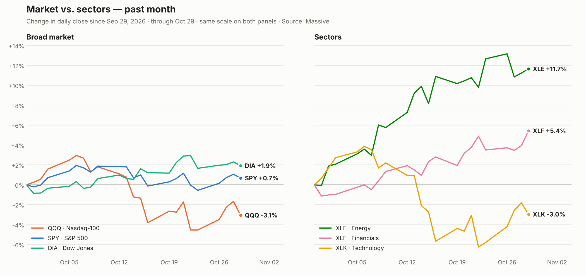
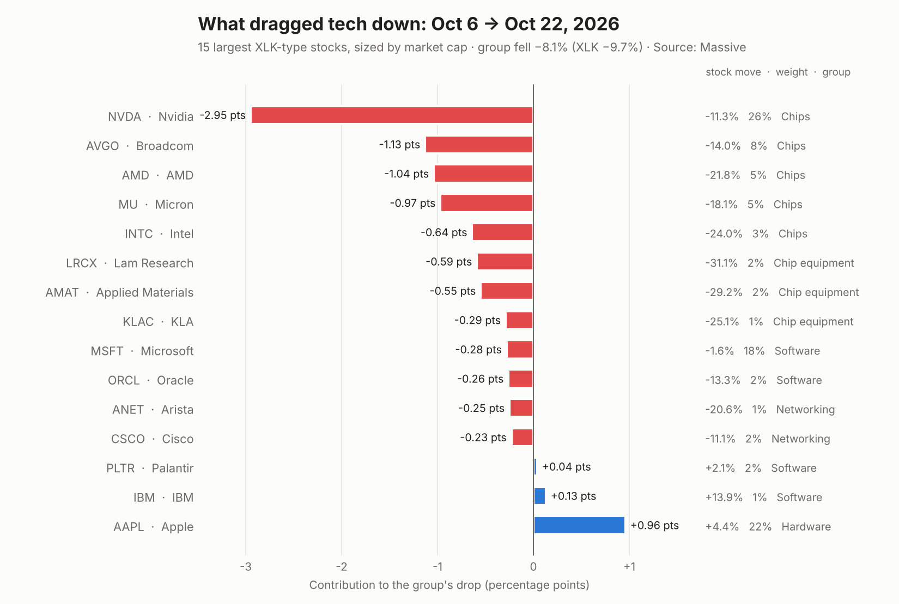
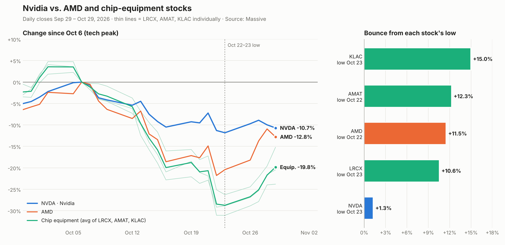

# October 2026 chip selloff

Daily closes Sep 29 – Oct 29, 2026 from Massive (`/v2/aggs`), news from Massive's
news feed (`/v2/reference/news`). Not investment advice.

## 1. Market vs. sectors



| ETF | Past month | Oct 6 → Oct 23 |
| --- | --- | --- |
| XLE (Energy) | +11.7% | +8.8% |
| XLF (Financials) | +5.4% | +3.5% |
| DIA (Dow) | +1.9% | +1.3% |
| SPY (S&P 500) | +0.7% | −2.5% |
| XLK (Technology) | −3.0% | −9.3% |
| QQQ (Nasdaq-100) | −3.1% | −7.3% |

Money rotated out of tech into energy and financials. See also
[`charts/etf_past_month.png`](charts/etf_past_month.png).

## 2. What dragged tech down (Oct 6 → Oct 22)



Chipmakers (−6.7 pts) and chip-equipment makers (−1.4 pts) account for the whole drop
of the 15 largest tech names; Nvidia alone was about −3 pts. Apple (+4.4%) cushioned it.
Weights are approximated from market cap because ETF holdings aren't in the current
Massive plan; XLK's actual capped weights differ.

**Why, per the news feed** (mostly Motley Fool and Zacks reporting):

1. **Oct 12–15:** Chinese DRAM maker CXMT's new architecture hit Micron (−13.5% that week).
2. **Oct 14–16:** rotation into defensive sectors on rate, energy-price and bubble worries;
   strong TSMC and ASML results didn't stop it.
3. **Oct 22:** oil at a five-month high plus Meta's negative free cash flow and capex jump
   raised doubts about AI-spending sustainability (AMD −8.1% that day).

## 3. Why Nvidia hasn't bounced



| Since Oct 6 | Lowest point | Bounce from low | Oct 29 |
| --- | --- | --- | --- |
| NVDA | −11.8% | +1.3% | −10.7% |
| AMD | −21.8% | +11.5% | −12.8% |
| Chip equipment (avg) | −28.7% | +10.6% to +15.0% | −19.8% |

Nvidia fell least but has barely recovered. News points to Nvidia-specific concerns:
Google selling TPUs and OpenAI reportedly buying them (Oct 28–29), customer-financing
worries (CoreWeave downgrade, bond-market stress, "circular financing"), weaker-than-hoped
China shipments, and "AI bubble" commentary aimed at the largest company.

## Regenerating the charts

```bash
pip install matplotlib
python scripts/etf_past_month.py
python scripts/market_vs_sectors.py      # reads scripts/etf_closes.json
python scripts/xlk_drop_drivers.py
python scripts/nvda_vs_amd_equipment.py
```

Price data is embedded in the scripts (or `etf_closes.json`) as fetched on Oct 30, 2026,
so the charts reproduce exactly without an API key.
